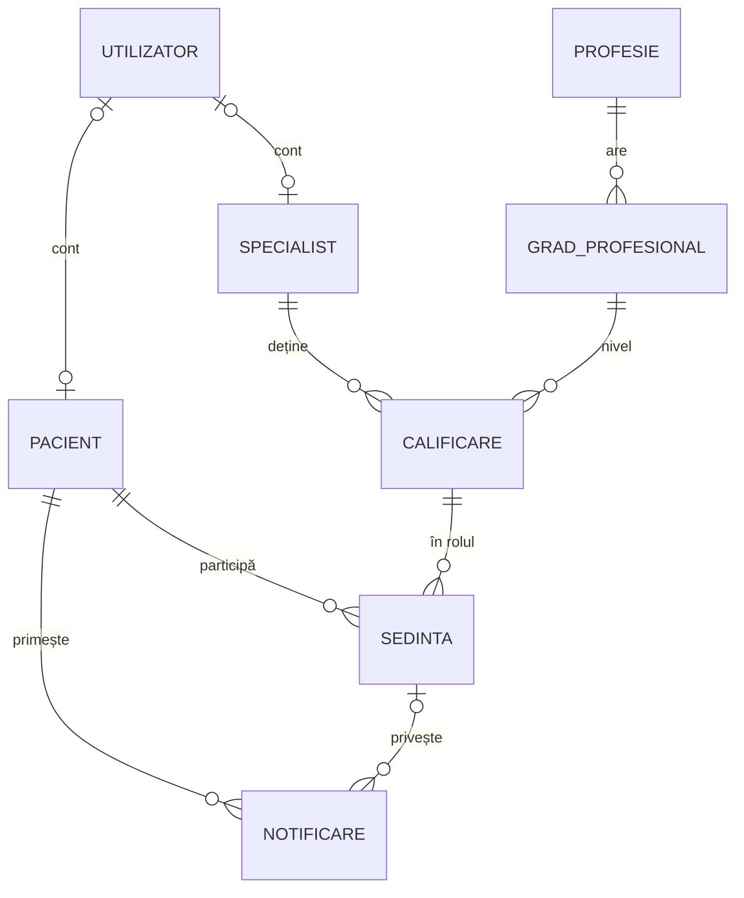

# Cabinet de telemedicină – sănătate mintală

Aplicație web pentru un cabinet de telemedicină specializat în sănătate mintală. Toate consultațiile au loc exclusiv online, prin video: consultații de psihiatrie, ședințe de psihoterapie și evaluări de psihologie clinică. Proiectul este realizat pentru disciplina Baze de Date 2.

Am ales sănătatea mintală pentru că este domeniul medical cel mai potrivit pentru telemedicină. Diagnosticul și tratamentul se bazează pe discuție, observație și chestionare standardizate, nu pe examen fizic sau pe instrumente (stetoscop, analize), care nu pot fi folosite la distanță.

Stadiu actual: etapa 1 este implementată. Ea cuprinde persoanele, rolurile profesionale, documentele de practică, ședințele online și notificările. Operațiile CRUD sunt disponibile prin panoul de administrare Django. Etapele 2–4 (tratament, chestionare, alerte, diagnostice) sunt proiectate, dar nu încă implementate (secțiunea 11).

## 1. Tehnologii folosite

| Componentă | Tehnologie | Versiune |
|---|---|---|
| Limbaj | Python | 3.12 |
| Framework web | Django | 6.1.2 |
| Bază de date | PostgreSQL, găzduit în cloud pe Neon | – |
| Driver PostgreSQL | psycopg | 3.3.6 |
| Citire variabile de mediu | python-dotenv | 1.2.4 |

Lista completă a pachetelor, cu versiuni exacte, se află în `requirements.txt`.

## 2. Structura proiectului

| Fișier / folder | Rol |
|---|---|
| `config/settings.py` | configurare: aplicații, bază de date, limbă, fus orar |
| `config/urls.py` | rutele aplicației (momentan doar `/admin/`) |
| `clinica/models.py` | modelele, adică tabelele bazei de date, și regulile lor |
| `clinica/admin.py` | panoul de administrare: liste, filtre, acțiuni |
| `clinica/migrations/` | istoricul structurii bazei de date |
| `test1.sql` | script cu date de test fictive |
| `manage.py` | utilitarul de linie de comandă Django |
| `requirements.txt` | dependențele Python |
| `.env` | date secrete (nu se urcă pe git) |
| `.gitignore` | fișierele ignorate de git |

## 3. Domeniul aplicației

Cabinetul lucrează cu trei profesii:

| Profesie | Ce face | Poate prescrie medicamente | Organism emitent |
|---|---|---|---|
| psihiatru | consultații medicale, diagnostic, tratament medicamentos | da | Colegiul Medicilor din România |
| psihoterapeut | ședințe de psihoterapie | nu | Colegiul Psihologilor din România |
| psiholog clinician | evaluare psihologică | nu | Colegiul Psihologilor din România |

Un specialist poate avea mai multe profesii în același timp. De exemplu, un medic psihiatru poate fi și psihoterapeut format. Fiecare profesie are grade, stabilite prin legislație:
- psihiatru: rezident → specialist → primar
- psihoterapeut: în formare → sub supervizare → autonom
- psiholog clinician: practicant → specialist → principal

Dreptul de practică se dovedește printr-un document emis de organismul profesional: codul de parafă pentru medici, atestatul pentru psihoterapeuți și psihologi. Aplicația nu generează aceste coduri. Ele se introduc și se verifică manual în registrul oficial al organismului.

## 4. Modelul de date

### 4.1 Diagrama entitate-relație



Relațiile, pe scurt:
- Un utilizator (cont de login) poate fi legat de cel mult un pacient și de cel mult un specialist. Un pacient sau un specialist poate exista și fără cont.
- O profesie are mai multe grade, iar fiecare grad aparține unei singure profesii.
- Un specialist deține mai multe calificări (documente), fiecare pentru un anumit grad.
- Un pacient participă la mai multe ședințe. Fiecare ședință este ținută pe baza unei calificări, de unde se știe și cine a ținut-o, și în ce rol.
- Un pacient primește notificări, care se pot referi la o ședință.

### 4.2 Tabele

Django denumește tabelele după regula `aplicatie_model`. Fiecare tabel are o cheie primară `id` (bigint, generată automat).

| Model | Tabel | Ce păstrează |
|---|---|---|
| `Utilizator` | `clinica_utilizator` | contul de login: username, parola criptată, permisiuni |
| `Pacient` | `clinica_pacient` | fișa pacientului |
| `Specialist` | `clinica_specialist` | fișa profesională a specialistului |
| `Profesie` | `clinica_profesie` | catalogul profesiilor și drepturile lor |
| `GradProfesional` | `clinica_gradprofesional` | catalogul gradelor, cu poziția în ierarhie |
| `Calificare` | `clinica_calificare` | documentele de practică ale specialiștilor |
| `Sedinta` | `clinica_sedinta` | ședințele online |
| `Notificare` | `clinica_notificare` | mesajele pentru pacienți |

Tabele create automat de Django:
- `clinica_utilizator_groups`, `clinica_utilizator_user_permissions`: legătura conturilor cu grupuri și permisiuni
- `auth_*`, `admin_*`, `django_*`: tabele interne (permisiuni, sesiuni, jurnalul panoului de administrare)

Pacient:

| Coloană | Tip | Observații |
|---|---|---|
| `nume`, `prenume` | varchar(100) | obligatorii |
| `data_nasterii` | date | nu poate fi în viitor |
| `sex` | varchar(1) | F / M / A (altul), opțional |
| `email` | varchar(254) | opțional, nu este unic (ex: un părinte pentru mai mulți copii) |
| `telefon` | varchar(20) | opțional |
| `contact_urgenta_nume`, `contact_urgenta_telefon` | varchar | persoana de contact în caz de criză |
| `data_consimtamant` | timestamp | acordul pentru prelucrarea datelor (GDPR) |
| `data_inregistrare` | timestamp | completată automat |
| `utilizator_id` | FK → Utilizator | opțional, unic |

Specialist:

| Coloană | Tip | Observații |
|---|---|---|
| `nume`, `prenume` | varchar(100) | obligatorii |
| `email` | varchar(254) | obligatoriu, unic |
| `telefon` | varchar(20) | opțional |
| `descriere` | text | prezentare vizibilă pacienților |
| `accepta_pacienti_noi` | boolean | oprește programările noi fără a șterge specialistul |
| `data_inregistrare` | timestamp | completată automat |
| `utilizator_id` | FK → Utilizator | opțional, unic |

Profesie:

| Coloană | Tip | Observații |
|---|---|---|
| `nume` | varchar(50) | unic |
| `organism_emitent` | varchar(100) | cine emite documentele de practică |
| `poate_prescrie` | boolean | dreptul de a prescrie medicamente |
| `poate_diagnostica` | boolean | dreptul de a pune diagnostice |
| `grade_ierarhice` | boolean | dacă legislația stabilește o ierarhie a gradelor |

GradProfesional:

| Coloană | Tip | Observații |
|---|---|---|
| `profesie_id` | FK → Profesie | obligatoriu |
| `nume` | varchar(50) | unic în cadrul profesiei |
| `ordine` | smallint | poziția în ierarhie (1 = cel mai mic). Obligatorie dacă profesia are grade ierarhice |
| `poate_superviza` | boolean | gradul permite supervizarea altor specialiști |

Calificare (un document de practică):

| Coloană | Tip | Observații |
|---|---|---|
| `specialist_id` | FK → Specialist | obligatoriu |
| `grad_id` | FK → GradProfesional | obligatoriu |
| `domeniu` | varchar(150) | ex: psihoterapie cognitiv-comportamentală. Opțional |
| `nr_document` | varchar(50) | codul de parafă sau numărul atestatului |
| `data_obtinere` | date | obligatorie |
| `data_expirare` | date | opțională (gol = nu expiră) |
| `activa` | boolean | documentul curent |
| `tarif_sedinta` | numeric(8,2) | tariful unei ședințe în acest rol |
| `verificata`, `verificata_de_id`, `verificata_la` | boolean, FK, timestamp | confirmarea în registrul oficial: dacă, cine și când |
| `motiv_dezactivare`, `dezactivata_de_id`, `dezactivata_la` | varchar, FK, timestamp | de ce, cine și când a dezactivat documentul |

Sedinta:

| Coloană | Tip | Observații |
|---|---|---|
| `pacient_id` | FK → Pacient | obligatoriu |
| `calificare_id` | FK → Calificare | documentul pe baza căruia se ține ședința |
| `data_ora` | timestamp | cu fus orar |
| `durata_minute` | smallint | mai mare decât 0 |
| `status` | varchar(15) | programată / finalizată / anulată / neprezentare |
| `link_intalnire` | varchar(200) | legătura pentru întâlnirea video |
| `pret` | numeric(8,2) | copiat din tarif la programare |
| `note_confidentiale` | text | vizibile doar specialistului |
| `motiv_anulare`, `anulata_la` | varchar, timestamp | completate doar la anulare |
| `creata_la` | timestamp | completată automat |

Notificare:

| Coloană | Tip | Observații |
|---|---|---|
| `pacient_id` | FK → Pacient | obligatoriu |
| `sedinta_id` | FK → Sedinta | opțional |
| `tip` | varchar(15) | anulare / mutare / alertă / informare |
| `mesaj` | text | textul mesajului |
| `creata_la` | timestamp | completată automat |
| `citita_la` | timestamp | când a fost citită în aplicație sau transmisă telefonic |

### 4.3 Relații

| Relație | Tip | Implementare |
|---|---|---|
| Utilizator – Pacient | 1:1 opțional | `pacient.utilizator_id`, UNIQUE, NULL permis |
| Utilizator – Specialist | 1:1 opțional | `specialist.utilizator_id`, UNIQUE, NULL permis |
| Profesie – GradProfesional | 1:N | `gradprofesional.profesie_id` |
| Specialist – GradProfesional | M:N cu atribute | tabelul asociativ `Calificare` (document, date, tarif, verificare) |
| Pacient – Sedinta | 1:N | `sedinta.pacient_id` |
| Calificare – Sedinta | 1:N | `sedinta.calificare_id` |
| Pacient – Notificare | 1:N | `notificare.pacient_id` |
| Sedinta – Notificare | 1:N opțional | `notificare.sedinta_id`, NULL permis |

### 4.4 Decizii de proiectare

1. Contul de login este separat de fișă. `Utilizator` conține doar datele de autentificare, iar `Pacient` și `Specialist` se leagă de el printr-o relație 1:1 opțională. Astfel un pacient poate exista fără cont (ex: un copil), aceeași persoană poate fi și pacient, și specialist, iar ștergerea contului nu șterge fișa, care trebuie păstrată prin lege.
2. Câmpurile comune (nume, prenume, telefon, data înregistrării) sunt definite o singură dată, în clasa abstractă `Persoana`. Ea nu creează un tabel: câmpurile ei sunt copiate în `clinica_pacient` și `clinica_specialist`.
3. Profesia și gradul sunt în tabele separate (3NF). Dreptul de a prescrie depinde de profesie, nu de grad. Într-un singur tabel profesie + grad, valoarea s-ar repeta pe fiecare grad (dependență tranzitivă).
4. `Calificare` este un tabel asociativ între specialist și grad. Fiecare rând este un document real, cu numărul, datele și starea lui, deci un specialist poate avea oricâte profesii.
5. Ședința indică o calificare, nu un specialist. Astfel se știe nu doar cine a ținut ședința, ci și în ce rol (ex: consultație psihiatrică sau ședință de psihoterapie).
6. Prețul ședinței este copiat din tarif la programare. Este o denormalizare intenționată: dacă tariful crește, ședințele vechi păstrează prețul real.
7. Expirarea unui document nu se stochează ca stare. Ea rezultă din `data_expirare`, la fel cum vârsta rezultă din data nașterii. O stare „expirată” stocată ar deveni greșită dacă nu o actualizează nimeni.
8. Nimic din istoric nu se șterge. Documentele vechi rămân cu `activa = false`, iar ședințele anulate rămân cu status „anulată”, motiv și dată.
9. Cheile primare sunt chei surogat (`id`), folosite pentru toate legăturile. Codurile reale (numărul documentului, emailul) sunt păstrate ca date, cu constrângeri acolo unde este cazul.

## 5. Reguli de integritate

### 5.1 Constrângeri în baza de date

| Tabel | Constrângere | Regula |
|---|---|---|
| Profesie | UNIQUE (`nume`) | o profesie nu se definește de două ori |
| GradProfesional | `grad_nume_unic_pe_profesie` | UNIQUE (profesie, nume) |
| GradProfesional | `grad_ordine_unica_pe_profesie` | UNIQUE (profesie, ordine): două grade nu stau pe aceeași treaptă. Valorile NULL nu intră în conflict |
| GradProfesional | `grad_ordine_pozitiva` | CHECK (ordine IS NULL OR ordine >= 1) |
| Specialist | UNIQUE (`email`) | adresa profesională a unei singure persoane |
| Calificare | `calificare_expirare_dupa_obtinere` | data expirării este după data obținerii |
| Calificare | `calificare_tarif_pozitiv` | CHECK (tarif >= 0) |
| Calificare | `calificare_verificare_datata` | un document verificat are data verificării |
| Calificare | `calificare_activa_fara_dezactivare` | un document activ nu are motiv sau dată de dezactivare |
| Calificare | `calificare_motiv_si_data_dezactivare` | motivul și data dezactivării apar întotdeauna împreună |
| Sedinta | `sedinta_durata_pozitiva` | CHECK (durata > 0) |
| Sedinta | `sedinta_pret_pozitiv` | CHECK (preț >= 0) |
| Sedinta | `sedinta_anulare_completa` | anulată ⇔ are motiv și dată de anulare |

Pe lângă acestea există cheile primare și străine, cu index pe fiecare coloană cheie străină, și unicitatea legăturii 1:1 cu contul de login.

### 5.2 Reguli verificate în aplicație

Unele reguli privesc mai multe rânduri sau mai multe tabele, deci nu se pot exprima cu UNIQUE sau CHECK. Ele sunt verificate de Django la salvarea prin formulare și prin panoul de administrare:

| Regula | De ce nu e o constrângere |
|---|---|
| un specialist are cel mult un document activ pe profesie + domeniu | profesia se află în alt tabel (prin grad) |
| numărul documentului este unic în cadrul organismului emitent | organismul se află la două tabele distanță; același număr poate exista la organisme diferite |
| ordinea gradului este obligatorie la profesiile cu grade ierarhice | depinde de o valoare din tabelul profesiei |
| o ședință nouă se programează doar pe un document activ, verificat și neexpirat la data ședinței | depinde de alt tabel și de data ședinței |
| data nașterii nu este în viitor | depinde de data curentă |
| schimbarea numărului documentului sau a gradului anulează verificarea | depinde de valoarea anterioară |

Regulile care privesc alte tabele vor fi impuse și prin triggere PostgreSQL (secțiunea 11), ca să fie respectate și de comenzile SQL rulate direct.

### 5.3 Comportament la ștergere

| Relație | Regulă | Efect |
|---|---|---|
| Pacient → Sedinta | PROTECT | nu se poate șterge un pacient care are ședințe |
| Calificare → Sedinta | PROTECT | nu se poate șterge un document folosit în ședințe |
| Specialist → Calificare, GradProfesional → Calificare, Profesie → GradProfesional | PROTECT | catalogul și documentele folosite nu se pot șterge |
| Utilizator → Pacient / Specialist | SET_NULL | ștergerea contului păstrează fișa, fără cont |
| Utilizator → verificat / dezactivat de | SET_NULL | istoricul rămâne, fără numele contului șters |
| Sedinta → Notificare | SET_NULL | notificarea rămâne și fără ședință |
| Pacient → Notificare | CASCADE | notificările unui pacient se șterg odată cu el |

Aceste reguli sunt aplicate de Django. În SQL-ul generat nu apare `ON DELETE`, deci o comandă `DELETE` rulată direct în baza de date primește doar eroarea standard de cheie străină.

## 6. Operații de administrare

### 6.1 Stările unui document

| Stare | Când |
|---|---|
| activ | documentul curent al specialistului |
| în așteptare | document nou, adăugat inactiv, care așteaptă verificarea și activarea |
| dezactivat | are motiv, dată și persoana care l-a dezactivat |

Câmpul `activa` se alege doar la adăugarea documentului. După aceea starea se schimbă exclusiv prin acțiunile de mai jos.

### 6.2 Verificarea

Administratorul caută documentul în registrul oficial al organismului emitent și aplică acțiunea „Marchează ca verificate”. Aplicația completează automat cine a verificat și când.

### 6.3 Promovarea (activarea unui document nou)

Pașii:
1. Se adaugă documentul nou, inactiv („în așteptare”).
2. Se verifică.
3. Se aplică acțiunea „Activează”.

Acțiunea rulează într-o singură tranzacție, cu rândurile blocate (`SELECT ... FOR UPDATE`):
- documentul nou devine activ
- documentul vechi din aceeași profesie și domeniu este dezactivat, cu motivul „înlocuit de un document superior”
- programările viitoare se mută pe documentul nou, păstrându-și data și prețul
- pacienții afectați primesc o notificare

Dacă o programare ar cădea după expirarea documentului nou, activarea este refuzată și nu se modifică nimic. Un document înlocuit prin promovare nu mai poate fi reactivat.

### 6.4 Dezactivarea

Motivele posibile sunt: încetarea colaborării, suspendarea dreptului de practică, retragerea dreptului de practică și document introdus greșit. Tot într-o singură tranzacție:
- documentul devine inactiv, cu motiv, dată și autor
- programările viitoare sunt anulate (nu șterse), cu motivul „specialistul nu mai este disponibil”
- pacienții afectați primesc o notificare

Un document suspendat poate fi reactivat ulterior.

### 6.5 Notificări

Pacienții cu cont vor vedea notificările în aplicație. Pentru pacienții fără cont, panoul de administrare oferă lista „de contactat telefonic”, cu telefonul pacientului sau, dacă acesta lipsește, cu cel al persoanei de contact. După apel, notificarea se marchează ca transmisă.

### 6.6 Permisiuni

Acțiunile de verificare, activare și dezactivare cer permisiunea „Poate verifica, activa și dezactiva calificări”. Superuserul o are automat. Pentru alți administratori, ea se acordă individual, astfel încât istoricul să arate cine a făcut fiecare operație.

Integritatea datelor este impusă în baza de date, iar autorizarea (cine are voie să facă o operație) în aplicație. PostgreSQL nu știe ce utilizator este autentificat în aplicație, pentru că aplicația se conectează la baza de date mereu cu același cont.

## 7. Date de test

Scriptul `test1.sql` introduce date fictive: nume inventate, adrese @example.com și numere de document cu prefixul TEST.

| Tabel | Rânduri |
|---|---|
| profesii | 3 |
| grade profesionale | 9 |
| specialiști | 5 |
| calificări | 9 |
| pacienți | 8 |
| ședințe | 21 |
| notificări | 4 |

Situațiile ilustrate:
- un specialist cu două profesii active (psihiatru și psihoterapeut)
- o promovare: documentul vechi păstrat în istoric, programările viitoare mutate pe documentul nou, pacienții notificați
- un document nou „în așteptare”, încă neverificat
- un specialist care nu mai colaborează cu clinica: programările anulate automat, pacienții notificați
- pacienți minori fără cont, cu persoană de contact și cu emailul comun al părintelui
- ședințe finalizate, programate, anulate și o neprezentare

Datele ședințelor sunt relative la ziua rulării, ca scriptul să rămână realist. Scriptul poate fi rulat de mai multe ori fără să dubleze datele (`ON CONFLICT DO NOTHING` și `WHERE NOT EXISTS`). La final conține interogări pentru prezentare, ca de exemplu ședințele cu rolul specialistului sau istoricul documentelor.

Rulare: consola Neon → SQL Editor → se lipește tot scriptul → Run. Alternativ: `python manage.py dbshell`, apoi `\encoding UTF8` și `\i test1.sql`.

## 8. Configurare și securitate

Datele secrete nu sunt scrise în cod. Ele se citesc din variabile de mediu:

| Variabilă | Rol |
|---|---|
| `DATABASE_URL` | șirul de conexiune la baza de date Neon |
| `DJANGO_SECRET_KEY` | cheia secretă Django |
| `DJANGO_DEBUG` | `True` local, `False` în producție |
| `DJANGO_ALLOWED_HOSTS` | domeniile acceptate (implicit `localhost,127.0.0.1`) |

- Local, variabilele se află în fișierul `.env`, exclus din git prin `.gitignore`.
- Pe un server de găzduire, variabilele se setează din panoul de control al serviciului.
- Conexiunea la Neon folosește obligatoriu SSL (`sslmode=require`).
- Limba aplicației este româna (`ro`), iar fusul orar este `Europe/Bucharest`.
- În timpul dezvoltării se folosesc doar date fictive, nu date reale ale pacienților (GDPR).

## 9. Instalare și rulare

Pașii se execută în PowerShell, în folderul proiectului:

1. Crearea și activarea mediului virtual:
```powershell
python -m venv .venv
.\.venv\Scripts\Activate.ps1
```
2. Instalarea dependențelor:
```powershell
pip install -r requirements.txt
```
3. Crearea fișierului `.env`, cu variabilele `DATABASE_URL`, `DJANGO_SECRET_KEY` și `DJANGO_DEBUG`.
4. Crearea tabelelor în baza de date:
```powershell
python manage.py migrate
```
5. Crearea unui cont de administrator:
```powershell
python manage.py createsuperuser
```
6. Opțional, încărcarea datelor de test, cu scriptul `test1.sql` (secțiunea 7).
7. Pornirea serverului de dezvoltare:
```powershell
python manage.py runserver
```

Panoul de administrare este disponibil la adresa `http://127.0.0.1:8000/admin/`.

Pentru a vedea codul SQL generat pentru tabele se folosește comanda `python manage.py sqlmigrate clinica 0001`.

## 10. Testare

Regulile din secțiunile 5 și 6 au fost verificate automat pe o bază de date PostgreSQL de test, separată, creată și ștearsă la fiecare rulare: constrângerile, promovarea și dezactivarea în tranzacție, revenirea la starea inițială la o activare refuzată, permisiunile și paginile panoului de administrare. Scriptul `test1.sql` a fost verificat la fel: rulat de două ori, fiecare rând trecut prin validarea Django.

Verificările au fost rulate temporar și nu fac încă parte din proiect. O suită de teste permanentă (`clinica/tests.py`) este planificată.

## 11. Etape următoare

Proiectate, neimplementate încă:

| Etapa | Conținut |
|---|---|
| 2. Tratament | `PlanTratament`, `Medicament`, `MedicamentPrescris`. Recomandările nemedicamentoase sunt un câmp text al planului. Doar profesiile cu `poate_prescrie` pot adăuga medicamente |
| 3. Chestionare | chestionare standardizate de screening (ex: PHQ-9 pentru depresie, GAD-7 pentru anxietate): `SablonRaspuns`, `OptiuneSablon`, `Chestionar`, `Intrebare`, `PragInterpretare`, `AplicareChestionar`, `Raspuns`. Se păstrează și scorul, și fiecare răspuns |
| 3. Siguranță și diagnostic | `Alerta` (creată automat când un răspuns depășește pragul de alertă al întrebării), `CodDiagnostic` (catalog ICD-10, capitolul F), `Diagnostic` (doar profesiile cu `poate_diagnostica`) |
| 4. Triggere PostgreSQL | regulile din secțiunea 5.2 care privesc alte tabele, regula de prescriere, crearea automată a alertelor |
| Aplicație | pagini proprii pentru pacienți și specialiști, autentificare, găzduire online, algoritmi de sprijin pentru decizia clinică pe baza istoricului chestionarelor |

Probleme deschise:
- `organism_emitent` este text liber. Dacă numele aceluiași organism este scris diferit la două profesii, regula de unicitate a documentului nu le mai recunoaște ca fiind același organism. Soluția este un tabel separat, `OrganismEmitent`.
- Cine poate pune diagnostice în afara psihiatrilor (ex: psihologii clinicieni, pentru evaluări psihologice) trebuie stabilit conform legislației.
- Textul chestionarelor trebuie preluat din traducerile oficiale validate, iar numerele de urgență afișate pacienților din surse oficiale.
